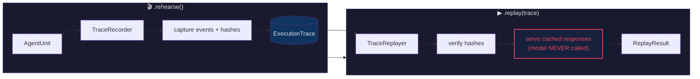

# Weft

Composable agent primitives for TypeScript.

---

## The problem

Coordinating multiple LLM calls in TypeScript usually means writing 80+ lines of scaffolding: promise chains, error handling, retry logic, consensus aggregation, and result tracking, before you get to any actual agent logic.

Weft replaces that scaffolding with a small algebra. The same coordination patterns, retry, fallback, parallel consensus, iterative refinement, compose as method chains on a single type: `AgentUnit<T>`.

### Multi-agent consensus in 10 lines

Three agents vote on whether a contract clause is fair. Parallel execution, weighted voting, confidence tracking, all composed:

```typescript
import { AgentUnit, createContext } from "weft-core";

const ctx = createContext();

const result = await AgentUnit.from(async () =>
  "The contractor shall bear all costs arising from delays, regardless of cause."
)
  .consensus([
    (clause) => analyseAsLegalExpert(clause),
    (clause) => analyseAsContractor(clause),
    (clause) => analyseAsMediator(clause),
  ])
  .run(ctx);

console.log(result.value.approved);      // false
console.log(result.value.weightedApproval);  // 0.33
console.log(result.value.votes);          // [{decision: 'reject', confidence: 0.92, ...}]
```

No agent registration. No routing config. No network topology. Hand it functions, get a consensus result with provenance.

### Simple AI calls with the Weft facade

For single-prompt work, the `Weft` callable is the fastest path:

```typescript
import { Weft } from "weft-core/server";

Weft.configure({ provider: "anthropic", model: "claude-sonnet-4-20250514" });

const result = await Weft("Summarise this contract in three bullet points");
console.log(result.value);
```

### From single call to coordination: `.coordinate()`

The facade and the coordination algebra connect through `.coordinate()`. Start simple, compose up:

```typescript
const result = await Weft("Analyse this contract clause for risk")
  .coordinate()
  .consensus([
    (analysis) => reviewAsLegalCounsel(analysis),
    (analysis) => reviewAsProjectManager(analysis),
    (analysis) => reviewAsFinanceDirector(analysis),
  ])
  .retry(2)
  .run(ctx);
```

One import. One namespace. The same chain handles AI execution, multi-agent coordination, and resilience.

### Resilience without coordination

If you just need retry, timeout, and fallback, that composes too:

```typescript
const result = await AgentUnit.from(async () => {
  const resp = await fetch("https://api.openai.com/v1/chat/completions", {
    method: "POST",
    headers: { Authorization: `Bearer ${process.env.OPENAI_API_KEY}`, "Content-Type": "application/json" },
    body: JSON.stringify({ model: "gpt-4o", messages: [{ role: "user", content: "Summarise this: ..." }] }),
  });
  return (await resp.json()).choices[0].message.content as string;
})
  .retry(3, { baseDelayMs: 500 })
  .timeout(10_000)
  .fallback(AgentUnit.of("Summary unavailable."))
  .run(ctx, { trustMode: "legacy" });
```

**Equivalent without Weft: ~80 lines** of try/catch, `Promise.race`, setTimeout, custom error classes, and a `while` loop.

---

## Install

```
pnpm add weft-core
```

Node 18+. No required peer dependencies for the core package.

---

## Packages

| Package | Description | License |
|---|---|---|
| `weft-core` | `AgentUnit` algebra: operators, error handling, observability | MIT |
| `weft-react` | React hooks (`useWeftStream`, `AIErrorBoundary`) | MIT |
| `weft-convex` | Convex action bindings | MIT |
| `weft-cli` | Scaffolding and agent debugging CLI | MIT |
| `weft-mcp` | MCP server exposing Weft operations as tool calls | MIT |
| `weft-harness` | Unit-testing harness for AgentUnit compositions | MIT |
| `weft-testing` | Vitest utilities and mock factories | MIT |
| `weft-devtools` | Chrome DevTools extension bridge for agent traces | MIT |
| `weft-pro` | Organisational features: TaCo consensus, trust registry, antibodies | BSL 1.1 |

---

## Core operators

All operators on `AgentUnit<T>` are free (MIT). The full list:

**Composition**
- `.map(fn)` — transform the resolved value
- `.flatMap(fn)` / `.chain(fn)` — sequence two computations


**Resilience**
- `.retry(n, opts?)` — exponential backoff retry
- `.timeout(ms)` — hard deadline
- `.fallback(unit)` — backup AgentUnit on failure
- `.orElse(value)` — static value on failure

**Coordination**
- `AgentUnit.zipAll(units)` — parallel execution, ordered results
- `AgentUnit.race(units)` — return first to settle
- `.consensus(voters, opts?)` — single-round multi-voter decision
- `.converge(agents, opts?)` — iterative multi-agent refinement
- `.debate(agents, opts?)` — converge + unanimous sign-off
- `.dialectic(leader, advisors, opts?)` — thesis/antithesis/synthesis

**Reliability**
- `.rehearse(opts?)` — record execution trace
- `.replay(trace, opts?)` — deterministic replay
- `.solo(opts?)` — autonomous execution with confidence gate
- `.coherence(opts?)` — post-consensus coherence check
- `.interview(config)` — lazy human-in-the-loop configuration
- `.conduct(handlers)` — execute a pending interview

## Record & Replay

Weft's record/replay engine is the foundation for deterministic agent testing. Record a run once, replay it infinitely at zero cost. The agent body is **never called** during replay — responses come from the stored trace.



| Framework | Replay Type | Re-executes LLM? | Deterministic? | Costs Tokens? |
|---|---|---|---|---|
| **Weft** | Recorded trace replay | **No** | **Yes** | **No** |
| LangGraph | Time-travel from checkpoints | Yes | No | Yes |
| Mastra | No replay primitive | N/A | N/A | N/A |

**[Full architecture →](docs/ARCHITECTURE.md)**

> **Legal disclaimer — replay determinism.** `.replay()` replays a stored trace through the same operator logic with the same inputs, producing the same output _for a given version of Weft and a given underlying AI model_. It does **not** guarantee identical outputs across model version upgrades, provider API changes, or different runtime environments. Replay is a testing and debugging aid, not a cryptographic audit trail. Do not rely on replay parity as evidence of correctness in regulated or compliance-critical workflows without independent verification.

**Tracking**
- `.tracked(opts?)` — source-tracking wrapper
- `.tap(fn)` — side-effect without modifying value

**Observability** (also free, in `weft-core`)
- `observable(unit, opts?)` — emit trace entries for a unit
- `createOperatorSpan(type, name, parentSpanId?)` — manual span timing
- `getTraces()` / `clearTraces()` — in-memory trace store
- `configureObservability(opts)` — verbosity, cost/error tracking, collector

---

## Status

Pre-1.0. API is stabilising but may change between minor versions. We commit to a changelog entry for every breaking change and a migration path in the release notes.

---

## Demo

See the adversarial demo at [wefthq/weft-demo](https://github.com/wefthq/weft-demo) — a flaky agent that fails 80% of the time, recorded and replayed deterministically.

**[Full demo transcript →](docs/demo-transcript.md)**

Quick version:

```
# Phase 1: Flaky agent — 4/5 runs fail (genuinely non-deterministic)
Run 1: ✗ FAILED — POST /analyze → TIMEOUT
Run 2: ✗ FAILED — POST /analyze → TIMEOUT
Run 3: ✗ FAILED — POST /export → TIMEOUT
Run 4: ✓ SUCCESS — 5 results
Run 5: ✗ FAILED — POST /export → TIMEOUT

# Phase 2: .rehearse() captures a successful run
Attempt 3: ✓ Success — 2 events recorded

# Phase 3: .replay() — agent body NEVER called
Events replayed: 2/2
apiCallCount:    -999 (agent never ran!)
Replay matched:  ✓ YES
Divergences:     0

# Phase 4: Output matches exactly. Zero re-execution.
Exact match:      ✓ YES
Agent re-executed: ✓ NO (deterministic!)
```

---

## Documentation

- [Architecture](docs/ARCHITECTURE.md) — canonical vs mirror model, package structure, known asymmetries
- [Demo Transcript](docs/demo-transcript.md) — full adversarial demo output
- [GitHub Discussions](https://github.com/wefthq/weft/discussions) — questions, feature proposals, show-and-tell

---

## Contributing

See [CONTRIBUTING.md](CONTRIBUTING.md). Short version: this repo is a distribution mirror — source changes originate upstream. External contributions are reviewed here and backported. File bugs as Issues; propose features in Discussions first.

---

## Licence

`weft-core` and all packages except `weft-pro` are MIT.  
`weft-pro` is [Business Source License 1.1](packages/weft-pro/LICENSE) — source-available; converts to MIT on 2030-04-24.

See [LICENSE](LICENSE) for the full per-package breakdown.
