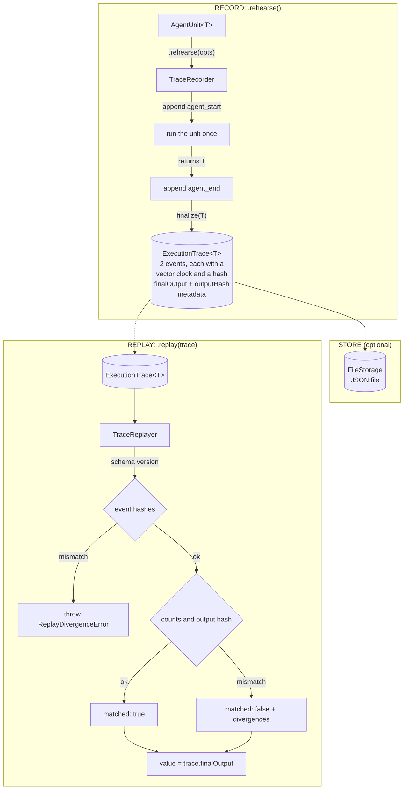

# Weft Architecture: Record and Replay

## Overview

`.rehearse()` runs an `AgentUnit` once and keeps the outcome in an `ExecutionTrace`. `.replay(trace)` hands that outcome back later without running the unit, after checking the trace has not been altered.

That is the whole of it today. The trace holds the outcome of a run, not the steps inside it.



## How it works

Source paths below are under `packages/weft-core/src/`.

### Record: `.rehearse(opts?)`

1. `.rehearse()` wraps the unit (`AgentUnit/operators/rehearsal.ts`). Nothing runs until you call `.run(ctx)`.
2. On run it creates a `TraceRecorder`, appends an `agent_start` event, runs the unit with the context you passed, then appends `agent_end` with the duration.
3. Every event gets an id, a timestamp, a vector clock and a DJB2 hash of its contents.
4. `finalize(output)` stores the final output, a DJB2 hash of it, and metadata: operator chain, event count, duration, schema version. The `events` and `checkpoints` arrays are frozen. The trace object itself is not.
5. The result is `{ value, trace }`.

Not recorded:

- **Model and tool calls.** `.rehearse()` creates a `RecordingLLMInterceptor`, but the unit runs with the plain context and nothing in `weft-core` routes provider calls through that interceptor. A unit that calls a model still produces only `agent_start` and `agent_end`.
- **Checkpoints.** The `checkpointInterval` option is accepted, but the automatic checkpoint branch in `rehearsal/recorder.ts` is empty. Checkpoints exist only when you call `createCheckpoint(state)` on a `TraceRecorder` yourself.

If the unit throws, `.rehearse()` throws too and you get no trace.

### Replay: `.replay(trace, opts?)`

1. `TraceReplayer` checks the trace's schema version against `TRACE_SCHEMA_VERSION`. Anything but an exact match throws `TraceVersionError`.
2. `DependencyScheduler` orders the events by vector clock.
3. Each event's hash is recomputed. A mismatch throws `ReplayDivergenceError`.
4. The event count and checkpoint count are compared with the metadata (warnings), and the output hash is recomputed (a mismatch is a critical divergence).
5. The result is `{ value: trace.finalOutput, matched, divergences, eventsReplayed, totalEvents }`. `matched` is true when every event was processed and there is no critical divergence.

The unit you call `.replay()` on is never run and never compared with the trace. Replay the same trace on a different unit and the result is identical, `matched: true` included.

### What you get, and the limits

- **No model call and no tokens on replay.** Nothing executes, so nothing is spent.
- **The same value every time.** Replay returns the stored output.
- **Integrity, not equivalence.** `matched` says the trace is intact. It does not say today's agent would produce that output. Replay cannot detect that an agent, a prompt or a model has changed.
- **A checksum, not a signature.** DJB2 is a fast 32-bit hash. It catches corruption and careless edits. Anyone who can edit the trace can recompute it.
- **On an edited output you still get the edited value.** `matched` is `false` and a critical divergence is listed, but `value` is whatever the trace now holds. Check `matched` before you use `value`.

## Building blocks you can use directly

The pieces under `.rehearse()` and `.replay()` are exported from `weft-core/rehearsal` (and from the `weft-core` root). If you want model calls in a trace, wrap them yourself:

```typescript
import {
  RecordingLLMInterceptor,
  TraceRecorder,
  TraceReplayer,
} from "weft-core/rehearsal";

// A stand-in for your own model call.
let modelCalls = 0;
const callModel = async (prompt: string) => {
  modelCalls++;
  return { response: `answer to: ${prompt}`, latencyMs: 1 };
};

// Record
const recorder = new TraceRecorder({ includePrompts: true });
const llm = new RecordingLLMInterceptor({ includePrompts: true });
recorder.installInterceptor(llm);
const first = await llm.recordCall({ model: "my-model", prompt: "hello" }, (cfg) => callModel(cfg.prompt));
recorder.createCheckpoint({ step: 1 });
const trace = recorder.finalize(first.response);
console.log(trace.events.map((e) => e.type)); // ["llm_call", "llm_response", "checkpoint"]

// Replay
const replayer = new TraceReplayer(trace);
const cached = await replayer.getLLMInterceptor()!.replayCall({ model: "my-model", prompt: "hello" });
const result = await replayer.replay();
console.log(cached.response, result.matched, modelCalls); // "answer to: hello" true 1
```

Two things to know before you lean on this:

- `replayCall()` serves recorded responses in the order they were recorded. It does not refuse a prompt that differs: a different prompt gets the recorded answer. One call more than was recorded throws.
- When the call you replay does not hash the same as the one recorded, it logs an `LLM call config mismatch` warning and still returns the recorded answer. The warning is the only signal: nothing throws. The hash covers the whole call config in the order its keys were written, so the same options in a different order also warn, and so does every call in a trace recorded before the config hash was stored.

## Component map

| Component | File | Role |
|---|---|---|
| `TraceRecorder` | `rehearsal/recorder.ts` | Appends events with vector clocks and hashes, takes explicit checkpoints, finalises traces |
| `TraceReplayer` | `rehearsal/replayer.ts` | Verifies hashes and counts, returns the stored output |
| `VectorClockManager` | `rehearsal/vectorClock.ts` | Vector clocks stamped on each event |
| `DependencyScheduler` | `rehearsal/scheduler.ts` | Orders events by vector clock for replay |
| `RecordingLLMInterceptor` | `rehearsal/interceptor.ts` | Records a model call you wrap with `recordCall()` |
| `ReplayLLMInterceptor` | `rehearsal/interceptor.ts` | Serves recorded responses in order |
| `CheckpointManager` | `rehearsal/checkpoint.ts` | Looks up, verifies and restores explicit checkpoints |
| `FileStorage` | `rehearsal/storage.ts` | Saves and loads traces as JSON files (default folder `__traces__`, optional gzip) |
| `TestHarness`, `assertDeterministic` | `rehearsal/testing.ts` | Test helpers built on the recorder and replayer |
| `ExecutionTrace<T>` | `rehearsal/types.ts` | The serialised trace data structure |
